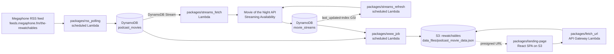

# Rewatchable Streams

Maps episodes of [The Rewatchables](https://www.theringer.com/the-rewatchables)
podcast to the streaming services where each movie can be watched, and publishes
the result as a searchable React web app.

The pipeline polls the show's RSS feed, resolves each episode's movie via TMDB,
fetches US streaming availability via the Movie of the Night (Streaming
Availability) API, and rebuilds a static JSON catalog that the web app loads
through a signed S3 URL.

## Architecture & Data Flow



1. **Ingest** — `rss_polling` polls the Megaphone RSS feed on a schedule, looks
   up each new episode's movie in TMDB, and writes it to `podcast_movies`.
2. **Enrich** — `streams_fetch` is triggered by the `podcast_movies` DynamoDB
   Stream, fetches streaming availability from the Movie of the Night API
   (via shared logic in `utils/streams.js`), and writes it to `movie_streams`.
3. **Refresh** — `streams_refresh` runs on a schedule and re-fetches streaming
   details for the oldest entries in `movie_streams` (queried via the
   `last_updated-index` GSI), so availability stays current within the API's
   daily quota.
4. **Publish** — `www_job` runs on a schedule, joins `podcast_movies` and
   `movie_streams`, and uploads the merged catalog as
   `data_files/podcast_movie_data.json` to the private S3 bucket `rewatchables`.
5. **Serve** — the `landing-page` React SPA (hosted on S3) calls the `fetch_url`
   Lambda through API Gateway, which returns a temporary presigned S3 URL
   (1 hour by default) for the catalog JSON. The bucket itself stays private.

## Repository Structure

| Path | Role |
| --- | --- |
| `packages/rss_polling` | Scheduled Lambda: polls the podcast RSS feed, resolves movies via TMDB, writes to `podcast_movies`. |
| `packages/streams_fetch` | Lambda triggered by the `podcast_movies` DynamoDB Stream: fetches streaming availability, writes to `movie_streams`. |
| `packages/streams_refresh` | Scheduled Lambda: re-fetches streaming details for the stalest `movie_streams` entries. |
| `packages/www_job` | Scheduled Lambda: joins both tables into `podcast_movie_data.json` and uploads it to S3. |
| `packages/fetch_url` | API Gateway Lambda: issues a presigned S3 URL for the catalog JSON. |
| `packages/landing-page` | React (Vite/MUI) web app served from S3. |
| `utils/` | Shared code, including `streams.js` (Movie of the Night fetch logic). |
| `bin/` | `initDynamo.js` (create the DynamoDB tables), `backfill-streams.js` (backfill `movie_streams` from `podcast_movies`). |
| `config.js` | Root config: environment, log level, and AWS/DynamoDB Local settings. |
| `samples/` | Example DynamoDB items, TMDB responses, and streaming entries. |
| `scripts/` | `smoke-signed-url.mjs` — smoke-test for the signed-URL flow. |

## Data Model & External APIs

DynamoDB tables are created by `node bin/initDynamo.js` (5 read/write capacity
units each):

- **`podcast_movies`** — partition key `pod_guid` (String). One item per podcast
  episode, with the resolved TMDB movie id.
- **`movie_streams`** — partition key `tmdb_id` (Number), with a global
  secondary index **`last_updated-index`** (`gsi_pk` hash, `last_updated`
  range) used by `streams_refresh` to find the stalest entries.

External dependencies:

- **Megaphone RSS feed** — `https://feeds.megaphone.fm/the-rewatchables`
- **TMDB API** — movie lookup by title
- **Movie of the Night (Streaming Availability) API** — US streaming availability
- **AWS** — DynamoDB, Lambda, EventBridge (schedules), API Gateway, S3

## Local Development Setup

### Prerequisites

- Node.js 22+ and npm
- Docker (for DynamoDB Local)
- AWS CLI (for deployment)

Install dependencies across all 8 subpackages from the repo root:

```bash
npm run install:all   # alias: npm run setup
```

### Configuration

Create a root `.env.json` (loaded via `dotenv-json`; gitignored — never commit
real keys):

```json
{
  "TMDB_API_KEY": "<your-tmdb-key>",
  "MOVIE_OF_THE_NIGHT_API_KEY": "<your-motn-key>",
  "DYNAMO_PODCAST_MOVIES_TABLE": "podcast_movies",
  "DYNAMO_MOVIE_STREAMS_TABLE": "movie_streams"
}
```

| Variable | Used by |
| --- | --- |
| `TMDB_API_KEY` | `rss_polling` (TMDB lookups) |
| `MOVIE_OF_THE_NIGHT_API_KEY` | `utils/streams.js` (streaming availability) |
| `DYNAMO_PODCAST_MOVIES_TABLE` | `rss_polling`, `streams_fetch`, `streams_refresh`, `bin/` |
| `DYNAMO_MOVIE_STREAMS_TABLE` | `streams_fetch`, `streams_refresh`, `bin/` |
| `PODCAST_MOVIES_TABLE`, `MOVIE_STREAMS_TABLE` | `www_job` (defaults `podcast_movies` / `movie_streams`) |
| `S3_BUCKET`, `S3_KEY` | `www_job`, `fetch_url` (defaults `rewatchables` / `data_files/podcast_movie_data.json`) |
| `URL_EXPIRY_SECONDS` | `fetch_url` (default `3600`) |
| `LOCAL_OUTPUT_PATH` | `www_job` — writes merged catalog JSON to disk and skips S3 upload |
| `VITE_DATA_URL` | `landing-page` — fetches catalog JSON directly from a local URL (e.g. `/local-data.json`) instead of prod API Gateway + S3 |
| `AWS_REGION`, `AWS_ACCESS_KEY_ID`, `AWS_SECRET_ACCESS_KEY` | AWS SDK v3 (required even for DynamoDB Local; any dummy values work locally) |
| `LOG_LEVEL`, `NODE_ENV` | `config.js` (`NODE_ENV=prod` uses real AWS; otherwise uses `http://localhost:8000`) |

### Bootstrapping a Local Environment

1. **Start DynamoDB Local** (use `-sharedDb` so all scripts and `dynamodb-admin` share one database):

   ```bash
   docker run -p 8000:8000 amazon/dynamodb-local -jar DynamoDBLocal.jar -inMemory -sharedDb
   ```

2. **Export local AWS env vars** in your terminal session:

   ```bash
   export AWS_REGION=us-east-2
   export AWS_ACCESS_KEY_ID=local
   export AWS_SECRET_ACCESS_KEY=local
   ```

3. **Create the local tables and open `dynamodb-admin`** (`http://localhost:8001`):

   ```bash
   node bin/initDynamo.js

   DYNAMO_ENDPOINT=http://localhost:8000 \
   AWS_REGION=us-east-2 \
   AWS_ACCESS_KEY_ID=local \
   AWS_SECRET_ACCESS_KEY=local \
   npx dynamodb-admin
   ```

   > If DynamoDB Local was started without `-sharedDb`, `dynamodb-admin` must use
   > the exact same `AWS_REGION` and `AWS_ACCESS_KEY_ID` as `initDynamo.js` or it
   > will show 0 tables.

4. **Populate data and build the local catalog JSON** (completely offline from AWS prod):

   ```bash
   # Poll the RSS feed -> populates podcast_movies
   node packages/rss_polling/app-local.js

   # Populate movie_streams (backfill all, or test a single sample event)
   node bin/backfill-streams.js
   # or: node packages/streams_fetch/app-local.js

   # Join tables into local JSON for the web client (skips S3 upload)
   LOCAL_OUTPUT_PATH=packages/landing-page/public/local-data.json \
   node packages/www_job/app-local.js
   ```

5. **Run the web client** (`http://localhost:5173`):

   ```bash
   # Against local DynamoDB data:
   cd packages/landing-page && VITE_DATA_URL=/local-data.json npm start

   # Or omit VITE_DATA_URL to load live production data from API Gateway + S3:
   cd packages/landing-page && npm start
   ```

   *(All Node.js packages log structured JSON via `pino`. Pipe any command through `| npx pino-pretty` for human-readable terminal output.)*

## Testing

Run the entire test suite from the repo root (shared fixtures, all 7 backend
packages, and the React frontend):

```bash
npm test
```

Targeted scripts:

- `npm run test:fixtures` — validates `test/fixtures.js` and `samples/` JSON schemas (`node --test`).
- `npm run test:backend` — runs Vitest across `packages/fetch_url`, `packages/rss_polling`, `packages/streams_fetch`, `packages/streams_refresh`, `packages/www_job`, `bin/`, and `utils/`.
- `npm run test:frontend` — runs Vitest + React Testing Library in `packages/landing-page`.
- `npm run build:frontend` — runs the Vite production build check in `packages/landing-page`.

GitHub Actions ([`.github/workflows/test.yml`](.github/workflows/test.yml)) runs
`test:fixtures`, `test:backend`, `test:frontend`, and `build:frontend` on every
push to `main` and pull request.

## Deployment

Lambda packages deploy with their own scripts (from the package directory):

```bash
cd packages/www_job && ./deploy.sh        # also: npm run deploy
cd packages/fetch_url && ./deploy.sh      # also: npm run deploy
```

`streams_refresh` gains the same `./deploy.sh` / `npm run deploy` flow once
PR #73 merges.

Frontend:

```bash
cd packages/landing-page && ./deploy-webapp.sh   # builds and syncs to s3://rewatchables/webapp/
```

Package-level details live in
[`packages/fetch_url/README.md`](packages/fetch_url/README.md),
[`packages/www_job/README.md`](packages/www_job/README.md), and
[`packages/landing-page/DEPLOYMENT.md`](packages/landing-page/DEPLOYMENT.md).
