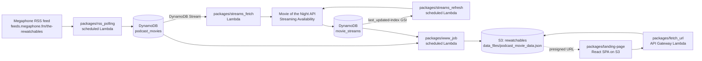

# Rewatchable Streams

Maps episodes of [The Rewatchables](https://www.theringer.com/the-rewatchables)
podcast to the streaming services where each movie can be watched, and publishes
the result as a searchable React web app.

The pipeline polls the show's RSS feed, resolves each episode's movie via TMDB,
fetches US streaming availability via the Movie of the Night (Streaming
Availability) API, and rebuilds a static JSON catalog that the web app loads
through a signed S3 URL.

## Architecture & Data Flow



1. **Ingest** — `rss_polling` polls the Megaphone RSS feed on a schedule, looks
   up each new episode's movie in TMDB, and writes it to `podcast_movies`.
2. **Enrich** — `streams_fetch` is triggered by the `podcast_movies` DynamoDB
   Stream, fetches streaming availability from the Movie of the Night API
   (via shared logic in `utils/streams.js`), and writes it to `movie_streams`.
3. **Refresh** — `streams_refresh` runs on a schedule and re-fetches streaming
   details for the oldest entries in `movie_streams` (queried via the
   `last_updated-index` GSI), so availability stays current within the API's
   daily quota.
4. **Publish** — `www_job` runs on a schedule, joins `podcast_movies` and
   `movie_streams`, and uploads the merged catalog as
   `data_files/podcast_movie_data.json` to the private S3 bucket `rewatchables`.
5. **Serve** — the `landing-page` React SPA (hosted on S3) calls the `fetch_url`
   Lambda through API Gateway, which returns a temporary presigned S3 URL
   (1 hour by default) for the catalog JSON. The bucket itself stays private.

## Repository Structure

| Path | Role |
| --- | --- |
| `packages/rss_polling` | Scheduled Lambda: polls the podcast RSS feed, resolves movies via TMDB, writes to `podcast_movies`. |
| `packages/streams_fetch` | Lambda triggered by the `podcast_movies` DynamoDB Stream: fetches streaming availability, writes to `movie_streams`. |
| `packages/streams_refresh` | Scheduled Lambda: re-fetches streaming details for the stalest `movie_streams` entries. |
| `packages/www_job` | Scheduled Lambda: joins both tables into `podcast_movie_data.json` and uploads it to S3. |
| `packages/fetch_url` | API Gateway Lambda: issues a presigned S3 URL for the catalog JSON. |
| `packages/landing-page` | React (Vite/MUI) web app served from S3. |
| `utils/` | Shared code, including `streams.js` (Movie of the Night fetch logic). |
| `bin/` | `initDynamo.js` (create the DynamoDB tables), `backfill-streams.js` (backfill `movie_streams` from `podcast_movies`). |
| `config.js` | Root config: environment, log level, and AWS/DynamoDB Local settings. |
| `samples/` | Example DynamoDB items, TMDB responses, and streaming entries. |
| `scripts/` | `smoke-signed-url.mjs` — smoke-test for the signed-URL flow. |

## Data Model & External APIs

DynamoDB tables are created by `node bin/initDynamo.js` (5 read/write capacity
units each):

- **`podcast_movies`** — partition key `pod_guid` (String). One item per podcast
  episode, with the resolved TMDB movie id.
- **`movie_streams`** — partition key `tmdb_id` (Number), with a global
  secondary index **`last_updated-index`** (`gsi_pk` hash, `last_updated`
  range) used by `streams_refresh` to find the stalest entries.

External dependencies:

- **Megaphone RSS feed** — `https://feeds.megaphone.fm/the-rewatchables`
- **TMDB API** — movie lookup by title
- **Movie of the Night (Streaming Availability) API** — US streaming availability
- **AWS** — DynamoDB, Lambda, EventBridge (schedules), API Gateway, S3

## Local Development Setup

### Prerequisites

- Node.js and npm
- AWS CLI (for deployment)
- DynamoDB Local on `http://localhost:8000` — used automatically by
  `config.js` whenever `NODE_ENV` is not `prod`

### Configuration

Copy the environment keys into a root `.env.json` (loaded via `dotenv-json`;
the file is gitignored — never commit real keys). Two naming families exist in
the codebase:

| Variable | Used by |
| --- | --- |
| `TMDB_API_KEY` | `rss_polling` (TMDB lookups) |
| `MOVIE_OF_THE_NIGHT_API_KEY` | `utils/streams.js` (streaming availability) |
| `DYNAMO_PODCAST_MOVIES_TABLE` | `rss_polling`, `streams_fetch`, `streams_refresh`, `bin/` |
| `DYNAMO_MOVIE_STREAMS_TABLE` | `streams_fetch`, `streams_refresh`, `bin/` |
| `AWS_REGION`, `AWS_ACCESS_ID`, `AWS_ACCESS_SECRET` | `config.js` (only in `prod`; local dev uses DynamoDB Local) |
| `LOG_LEVEL`, `NODE_ENV` | `config.js` (`NODE_ENV=prod` uses real AWS) |

`www_job` is the exception: it reads `PODCAST_MOVIES_TABLE` /
`MOVIE_STREAMS_TABLE` (defaults `podcast_movies` / `movie_streams`) and
`S3_BUCKET` / `S3_KEY` (defaults `rewatchables` /
`data_files/podcast_movie_data.json`). `fetch_url` also reads `S3_BUCKET`,
`S3_KEY`, and `URL_EXPIRY_SECONDS` (default `3600`).

### Bootstrapping

```bash
# Create the local DynamoDB tables
node bin/initDynamo.js

# Run a Lambda locally (each package has an app-local.js)
cd packages/rss_polling && npm install && node app-local.js

# Run the frontend
cd packages/landing-page && npm install && npm start   # http://localhost:5173
```

## Testing

Run the whole suite from the repo root — it runs Vitest in every package that
defines a test script:

```bash
npm test
```

Per-package notes:

- `packages/rss_polling`: `npm test` — has a real test suite
  (`test/extractMovieTitle.test.js`).
- `packages/fetch_url`, `packages/streams_fetch`, `packages/streams_refresh`,
  `packages/www_job`, `bin/`, `utils/`: `npm test` (Vitest, currently passing
  with no tests in most packages).
- `packages/streams_refresh`: unit tests arrive with the stream refresh
  framework (PR #73).
- `packages/www_job`: also ships `node test-simple.js`, a local run against
  mocked DynamoDB data.
- `packages/landing-page`: has no test script — verify with `npm run build`.

## Deployment

Lambda packages deploy with their own scripts (from the package directory):

```bash
cd packages/www_job && ./deploy.sh        # also: npm run deploy
cd packages/fetch_url && ./deploy.sh      # also: npm run deploy
```

`streams_refresh` gains the same `./deploy.sh` / `npm run deploy` flow once
PR #73 merges.

Frontend:

```bash
cd packages/landing-page && ./deploy-webapp.sh   # builds and syncs to s3://rewatchables/webapp/
```

Package-level details live in
[`packages/fetch_url/README.md`](packages/fetch_url/README.md),
[`packages/www_job/README.md`](packages/www_job/README.md), and
[`packages/landing-page/DEPLOYMENT.md`](packages/landing-page/DEPLOYMENT.md).
